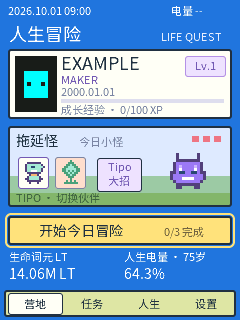
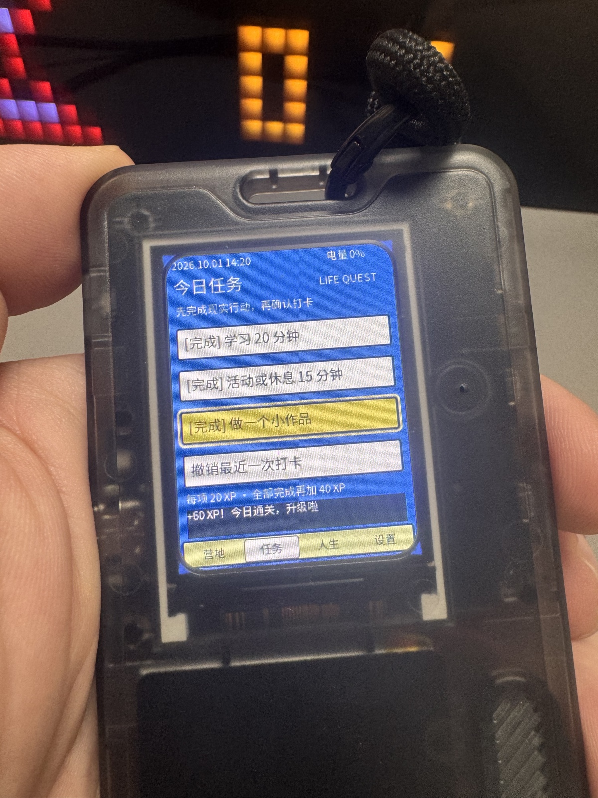

简体中文 · [English](README.md)

# 人生倒计时 / 人生冒险工牌

把随身工牌变成人生时间仪表盘：查看出生至今的时间、距离个人计划年龄的时间，以每日任务、经验值和原创像素伙伴记录行动。

这是 **FoloToy AI Passport 的真实工牌固件源码**，版本 `1.3.1-life-quest-public`。人生倒计时基础模型保留在 `main/life_countdown_model.c`，Life Quest 在此基础上增加离线任务、奖励、导航与设置。本仓库以干净快照开启公开历史，不包含原私有历史；也不是 iOS 应用或浏览器演示。

<p></p>

左图是本公开源码的原生 LVGL 渲染，**不是真机截图**。右图是作者提供的历史已安装 1.3 界面实物照片，不证明本公开版本已刷入设备。照片不含生日、个人时间数字或设备身份；EXIF、Photoshop 元数据已清除。

## 硬件与范围

只针对 FoloToy AI Passport 已知基线：ESP32-C3、8 MB Flash、240×320 屏幕、UP/DOWN/OK 三键、无 PSRAM；使用 ESP-IDF **5.5.3**。引脚与外设以 `components/bsp/include/bsp_pins.h` 为准。其他板卡及硬件修订未验证。本项目为独立社区作品，不是 FoloToy 官方固件发布。

- 完全离线，无账号、云服务、模型 API 密钥或配网流程。
- 虚构默认资料：`EXAMPLE / MAKER / 2000-01-01`、计划年龄 75，另一名字为 `SAMPLE2`。编译前可改 `main/life_profile.h`；几何示例头像可用 `python3 tools/generate_example_avatar.py` 重建。
- 设备已有 NVS 资料优先，升级不会自动改已有生日或经验。不要公开 NVS 或带个人时间数字的截图。
- 计划年龄是个人参考线，不是寿命预测。1 LT 为按日历换算的一分钟，不是模型词元或货币；任务加经验，不增加寿命或计划日期。

## 编译和启动

在仓库外安装 [ESP-IDF v5.5.3](https://github.com/espressif/esp-idf/tree/v5.5.3)：

```sh
git clone --branch v5.5.3 --recursive https://github.com/espressif/esp-idf.git ../esp-idf-v5.5.3
cd ../esp-idf-v5.5.3
./install.sh esp32c3
. ./export.sh
cd ../ai-passport-life-countdown-open-source
./tools/validate.sh --static
./tools/validate.sh --firmware
```

主机测试需 C 编译器和 Python 3。IDF Python 环境提供构建依赖，可选 USB 工具需 `pyserial==3.5`。`dependencies.lock` 锁定组件版本和摘要，复现时不要更新依赖。固件检查在全新临时目录构建，验证分区偏移、MD5、应用大小及身份区没有数据后，将分段产物放入被忽略的 `build/`。

**安装前必须阅读[安全刷机与恢复](docs/flashing.zh_CN.md)。** 禁止擦除整片 Flash、把合并镜像填充段写入已配身份的工牌，或覆盖 `cardid@0x356000`。

首次启动先进入设置校准日期与时间（中国时间），进入任务页，完成现实行动后再确认打卡。UP/DOWN 移动或编辑，OK 打开/确认，长按 OK 回营地并取消未完成编辑。每项 20 XP，三项全完成另加 40 XP，每 100 XP 升一级；任务第四项撤销最近打卡。TIPO 每天可消除一格怪物 HP，不加经验；另一伙伴是 REED。人生页有数字、LT、中国、世界、里程碑；设置可改资料、时钟、声音、动态，并二次确认清空游戏进度。五分钟无按键请求深睡，本版本的实体休眠/唤醒仍未实测。完全掉电需重新确认时钟，深睡保留时间。

[验证记录](docs/verification.zh_CN.md) 将本版本与历史 1.3.0 实机诊断分开。USB 的 `LQ_PROFILE` 会输出个人生日，诊断工具也能改时钟或模拟按键，只应明确用于自己的设备。本次发布未执行串口或刷机操作。

## 许可与维护边界

源码及原创像素素材采用 [MIT](LICENSE)，保留 © 2026 FoloToy 和 Lei Pan 两项署名。上游为 [FoloToy/ai-passport](https://github.com/FoloToy/ai-passport)。Noto 字体及子集仍遵循 SIL OFL 1.1，依赖保留各自许可。详见[归属和隐私边界](docs/attribution.zh_CN.md)。

维护范围为此硬件基线的离线工牌固件，不含历史网页原型、AB-731 考试内容、iOS 应用、个人固件备份或厂商身份配置。反馈请附版本、编译报错及复现步骤，先移除生日、个人时间数字、QR、身份、SSID 和含个人资料的日志。实体按键手感、声音、电量准确性、定时休眠/唤醒需设备拥有者实测。未来硬件/SDK 兼容性及维护时效不作保证。
